# Отчёт по практическому занятию 1: Docker

## Цель работы
Запустить сайт в Docker, собрать образ со своей страницей и проверить его работу в двух контейнерах.

## Ход выполнения

### 1. Проверка запуска Docker
Выполнена команда `docker version`. В выводе присутствуют разделы **Client** и **Server**, что подтверждает корректную работу Docker Desktop и интеграцию с WSL 2.

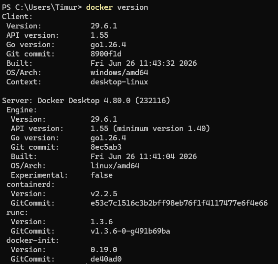

### 2. Запуск готового сайта (nginx)
Запущен контейнер `lab-web` на основе образа `nginx:stable-alpine` с пробросом порта `127.0.0.1:8083:80`. Контейнер успешно запущен, статус `Up`.

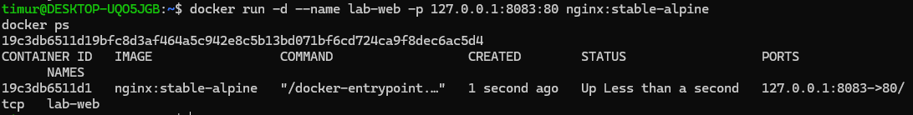

Проверена работа сайта в браузере по адресу `http://localhost:8083` — отображается стандартная страница **Welcome to nginx!**

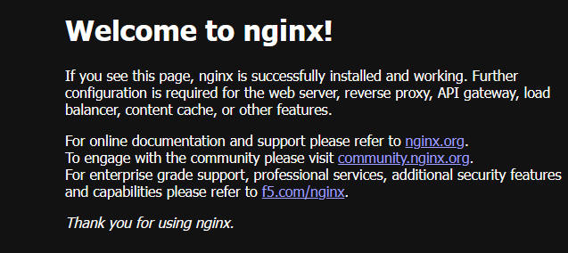

Проверена обработка ошибки 404: открыт адрес `http://localhost:8083/missing`, получена страница **404 Not Found**.

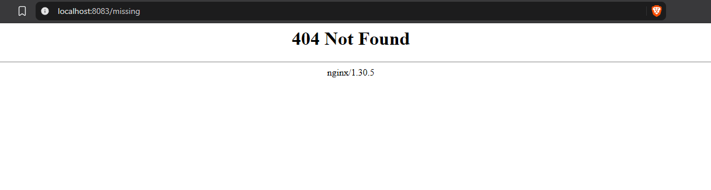

Просмотрены логи контейнера. В логах зафиксирован запрос `GET /missing` с кодом ответа 404.

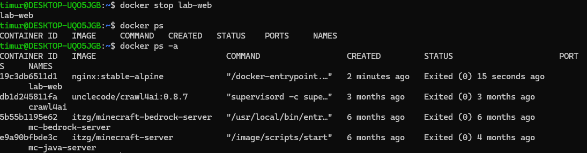

### 3. Остановка и повторный запуск сайта
Контейнер `lab-web` остановлен командой `docker stop lab-web`. В списке `docker ps` он отсутствует, но присутствует в `docker ps -a` со статусом `Exited`. При обновлении страницы сайт не загружается.

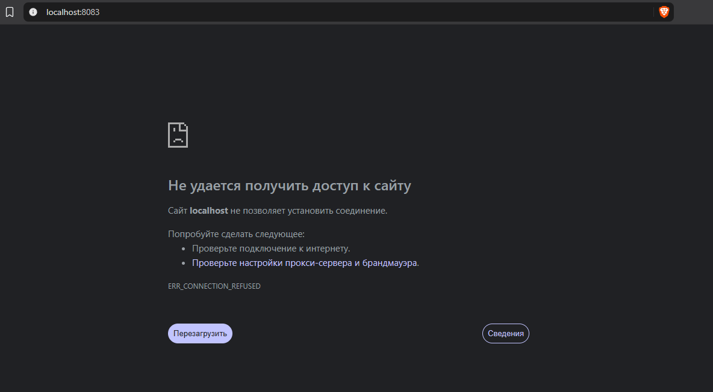

Страница сайта недоступна после остановки контейнера.

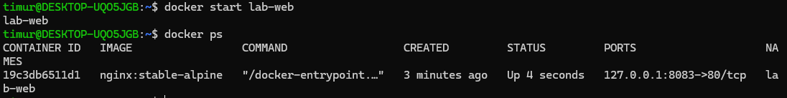

Контейнер снова запущен командой `docker start lab-web`. Статус снова `Up`, сайт открывается по прежнему адресу.

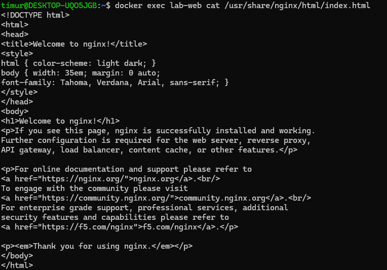

Проверено содержимое стартовой страницы внутри контейнера с помощью `docker exec lab-web cat /usr/share/nginx/html/index.html`. В выводе присутствует HTML с текстом **Welcome to nginx!**.

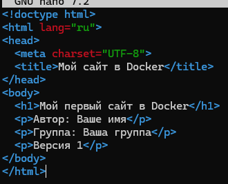

### 4. Подготовка файлов своего сайта
Создана папка `~/docker-lesson-01`. В ней создан файл `index.html` с персонализированным содержимым (указаны имя и группа, версия 1).

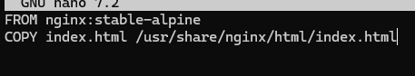

Создан файл `Dockerfile` с двумя строками:
FROM nginx:stable-alpine
COPY index.html /usr/share/nginx/html/index.html

text

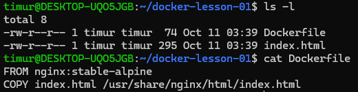

Проверено содержимое папки: файлы `index.html` и `Dockerfile` на месте, в Dockerfile ровно две строки.

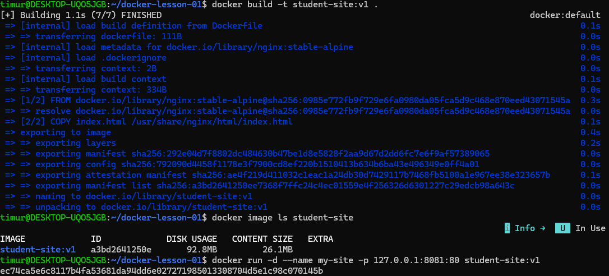

### 5. Сборка образа и запуск своего сайта
Собран образ `student-site:v1` командой `docker build -t student-site:v1 .`. Сборка прошла успешно.

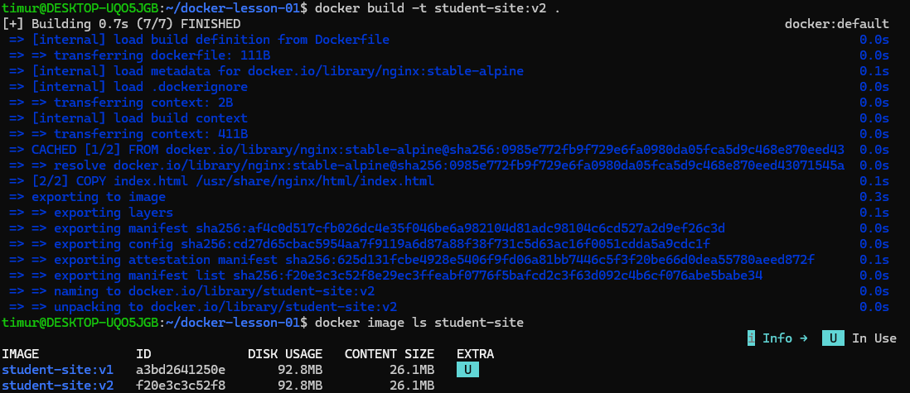

Запущен контейнер `my-site` на основе `student-site:v1` с пробросом порта `127.0.0.1:8081:80`.

### 6. Выпуск второй версии сайта
В файл `index.html` внесены изменения: «Версия 1» заменена на «Версия 2», добавлена строка «Обновление выполнено». Собран новый образ `student-site:v2`.

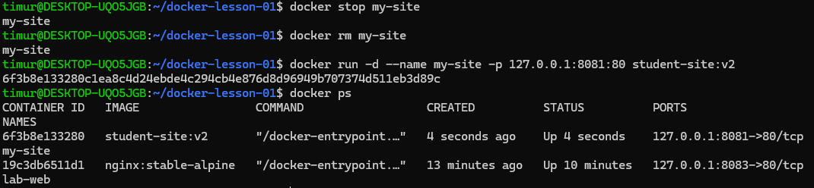

Старый контейнер `my-site` остановлен и удалён. Запущен новый контейнер `my-site` на основе `student-site:v2` с тем же портом `8081`.

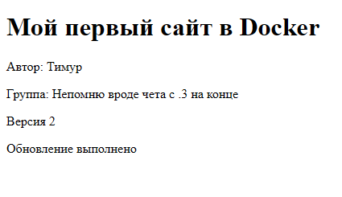

Проверена работа сайта: на странице отображаются имя автора, группа, «Версия 2» и «Обновление выполнено».

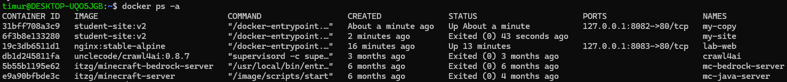

### 7. Запуск второго контейнера
Запущен второй контейнер `my-copy` на основе `student-site:v2` с пробросом порта `127.0.0.1:8082:80`. Первый контейнер `my-site` оставлен на порту `8081`.

Проверено, что оба контейнера работают независимо: при остановке `my-site` сайт на порту 8081 недоступен, а на порту 8082 продолжает работать.

Выполнена команда `docker ps -a`. Видно, что `my-site` имеет статус `Exited`, а `my-copy` — `Up`.

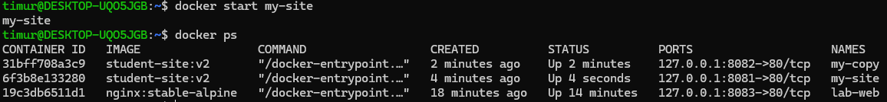

Контейнер `my-site` снова запущен. Убедились, что обе страницы доступны.

## Вывод
В ходе практического занятия были освоены базовые операции с Docker: запуск готовых контейнеров, управление их жизненным циклом, создание собственного образа на основе Dockerfile, публикация портов и запуск нескольких контейнеров из одного образа. Все задания выполнены успешно.
